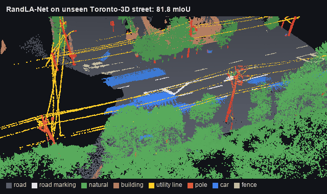
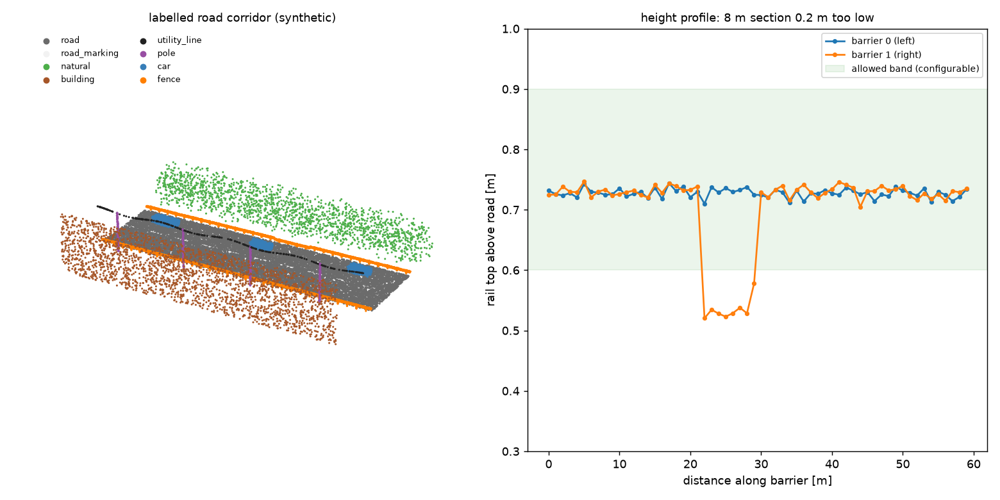
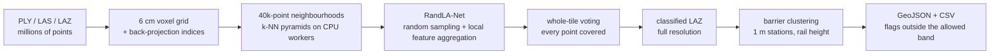

# LiDAR road-corridor segmentation and barrier measurement

Semantic segmentation of mobile-mapping point clouds with RandLA-Net, written in plain
PyTorch with no custom CUDA operators. The classified cloud is then turned into a guardrail
inspection: each barrier is extracted, cut into 1 m stations, and given its rail height above
the road surface. Out-of-range sections are flagged.

<p align="center"></p>
<sub>The test street of Toronto-3D (L002), which the network never saw in training, classified
point by point: 81.8 mIoU over eight classes.</sub>


<sub>Synthetic corridor with a deliberately lowered 8 m rail section. The profile on the right comes
from the measurement step and spots it immediately.</sub>

## Pipeline



- **Built for scale.** RandLA-Net replaces farthest-point sampling with random sampling, so
  memory and time grow linearly with the number of points. All neighbour, pooling and
  upsampling indices are built with SciPy k-d trees in the DataLoader workers, so the GPU only
  runs dense tensor operations. Training logs throughput in points per second.
- **Whole-tile inference.** Neighbourhoods are centred on the least-covered points until every
  point is covered, and class probabilities are averaged across overlaps. Predictions on the
  voxel cloud are projected back to every original point, so IoU is scored at full resolution.
  Output is LAZ that opens in CloudCompare or QGIS.
- **From labels to a measurement.** Barrier points are split into individual barriers
  (connected components on a voxel grid), stationed along their principal axis, and measured
  against a least-squares road plane, which follows grade and crossfall. On synthetic data
  with a 0.75 m rail the measured median is 0.73 m (the 95th-percentile top is slightly below
  the true edge), both from ground-truth and from predicted labels.
- **Any LAS/LAZ input**, e.g. Norwegian airborne laser data from hoydedata.no. A variant
  without colour (`configs/toronto3d_xyz_intensity.yaml`) covers scanners without RGB.

## Results

Toronto-3D (train L001/L003/L004, test L002, full-resolution IoU):

| Model | Features | mIoU | road | marking | natural | building | utility | pole | car | fence |
|---|---|---|---|---|---|---|---|---|---|---|
| RandLA-Net (this repo) | xyz + RGB + intensity | **81.78** | 96.78 | 64.79 | 96.65 | 93.29 | 85.48 | 78.22 | 94.31 | 44.69 |
| RandLA-Net, published | xyz + RGB | 81.77 | 96.69 | 64.21 | 96.92 | 94.24 | 88.06 | 77.84 | 93.37 | 42.86 |
| RandLA-Net (this repo) | xyz + intensity | **77.21** | 95.22 | 53.43 | 95.92 | 92.75 | 86.33 | 77.57 | 93.24 | 23.25 |
| RandLA-Net, published | xyz | 77.71 | 94.61 | 42.62 | 96.89 | 93.01 | 86.51 | 78.07 | 92.85 | 37.12 |

Published rows: Hu et al. (TPAMI 2021) as listed in the [Toronto-3D benchmark table](https://github.com/WeikaiTan/Toronto-3D).
The reimplementation adds intensity to both variants, so each pair differs in one input channel.
The fence class, which holds the guardrails, is the weakest class for every method in that table.

With colour, the reimplementation matches the published result (81.78 against 81.77 mIoU), and
the fence class comes out 1.8 points higher. Without colour, intensity makes up for most of what
RGB adds: 77.21 against the published 77.71 for geometry only. Road markings gain 11 points from
it (the paint is retroreflective), fences lose 14, which makes colour the input to keep for
guardrails.

On L002, the predicted fence points form 12 barriers, 129 m in total. The 7 with road surface
beside them get a height: medians from 0.52 m to 2.3 m. Most are garden fences and walls, which
share the class, so the height step is checked on synthetic corridors instead (0.73 m measured on
a 0.75 m rail, above), and a guardrail inventory needs a guardrail class of its own.

Sanity check on synthetic corridors (Apple M-series laptop, 6 short epochs): validation mIoU
went 0.26 → 0.98, and whole-tile inference with voting reaches 1.00 on that easy data.

## Quickstart

```bash
pip install -e ".[train]"
# Toronto-3D: see scripts/get_toronto3d.md
lidar-prepare-toronto3d --raw data/toronto3d --out data/toronto3d_prepared --voxel 0.06
lidar-train --config configs/toronto3d.yaml --set data.root=data/toronto3d_prepared
lidar-infer --checkpoint runs/randla_toronto3d/best.pt --tile data/toronto3d_prepared/L002.npz --out runs/L002.laz
lidar-barriers --tile data/toronto3d_prepared/L002.npz --labels runs/randla_toronto3d/L002_pred.npy --out runs/barriers
lidar-infer --checkpoint best.pt --input any_scan.laz                 # classify an arbitrary LAS/LAZ file
```

## Training on a GPU cluster (Slurm)

```bash
bash scripts/setup_cluster.sh                         # once, on a login node
python3 slurm/generate.py prepare --submit         # CPU: voxelisation of the four tiles
python3 slurm/generate.py train --submit           # A100: RandLA-Net, 100 x 500 steps
python3 slurm/generate.py train-no-rgb --submit
python3 slurm/generate.py test --submit            # whole-tile voting on L002
python3 slurm/generate.py barriers --submit
```

## Project layout

```
src/lidar_seg/
  io.py                PLY / LAS / LAZ, voxel-grid subsampling with majority labels
  data.py              neighbourhood sampling (class-balanced), k-NN pyramids, augmentation
  model.py             RandLA-Net: relative position encoding, attentive pooling, dilated residual blocks
  train.py             training loop: weighted CE, bf16, resumable checkpoints, points/s
  infer.py             whole-tile voting, full-resolution scoring, LAZ export
  barriers.py          barrier clustering, stationing, height above a fitted road plane, GeoJSON
  datasets/            Toronto-3D preparation; synthetic corridors for tests
tests/                 subsampling, label mapping, index pyramids, forward/backward, barrier heights, LAS round trip, train+infer smoke test
```

## Why RandLA-Net, and what is newer

RandLA-Net (2020) is no longer the state of the art. It stays here for three reasons: it needs
no custom CUDA operators, so it runs on any GPU, on a laptop and in CI; its random sampling
scales to the very large clouds of mobile mapping; and its published Toronto-3D numbers make
the reimplementation checkable.

Newer methods worth trying on this data:

- **Point Transformer V3** (Wu et al., CVPR 2024) orders points along space-filling curves and
  runs attention on fixed-size patches of that order. It is faster and more accurate than
  earlier point transformers, and leads outdoor benchmarks such as SemanticKITTI and nuScenes.
  It depends on sparse-convolution and FlashAttention CUDA kernels.
- **Sonata** (Wu et al., CVPR 2025) is self-supervised pretraining for PTv3. Pretrained point
  features help most when labels are scarce, which is the case for a dedicated guardrail class.
- On Toronto-3D itself, 2025 entries in the benchmark table reach 81-87 mIoU with RGB. Their
  largest gains over RandLA-Net are on the fence class (up to 78 vs. 43 IoU).

The natural next step is PTv3 from Pointcept on a GPU cluster (it needs CUDA), with the same
whole-tile voting and barrier measurement on top.

## Limitations

- Toronto-3D has a single `fence` class covering guardrails, fences and walls of similar
  height. A production model needs a dedicated guardrail class (e.g. KITTI-360 or own labels).
- Heights are measured relative to the nearest road surface. Barriers on embankments or
  behind kerbs need the inspection standard's reference point instead.
- Airborne data is much sparser than mobile mapping. Expect clearly lower barrier recall on it.

## References

- Hu et al., *RandLA-Net: Efficient Semantic Segmentation of Large-Scale Point Clouds*, CVPR 2020.
- Wu et al., *Point Transformer V3: Simpler, Faster, Stronger*, CVPR 2024.
- Wu et al., *Sonata: Self-Supervised Learning of Reliable Point Representations*, CVPR 2025.
- Tan et al., *Toronto-3D: A Large-scale Mobile LiDAR Dataset for Semantic Segmentation of Urban Roadways*, CVPRW 2020.
